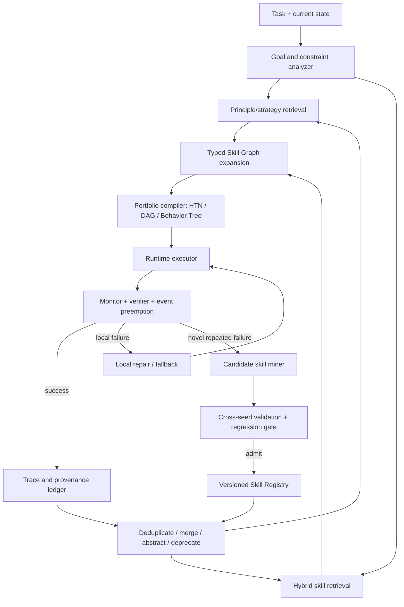

# 从机器人 Agent 到层次化技能系统：ASPIRE、Agentic Robot Control 与 Skill Library 范式调研

> 更新时间：2026-08-11  
> 主要材料：[ASPIRE: Agentic /Skills Discovery for Robotics](https://arxiv.org/abs/2607.00272)（本地 `Aspire.pdf`）与 [Agentic AI for Robot Control: Flexible but still Fragile](https://arxiv.org/abs/2602.13081)（本地 `2602.13081v1.pdf`）。  
> 文中“论文结论”尽量与作者原文区分；“综合判断”和“建议架构”是基于两篇论文及补充调研得到的分析。

## 0. 结论先行

两篇论文解决的是技能系统的两个不同断面：

- **Agentic AI for Robot Control** 解决“已有原子机器人技能时，如何让 LLM 在真实环境中规划、调用、监控和恢复”。它把 LLM 限制在高层决策层，用结构化状态、封闭动作 API、可供性、约束和 critic 缓解真实机器人执行的脆弱性。
- **ASPIRE** 解决“如何从机器人程序执行失败中发现可复用修复模式，并通过持续调试、验证和跨任务积累形成技能库”。它把软件工程中的 write-execute-debug 思路移植到 code-as-policy 机器人编程。

用户提出的判断总体正确，但需要两点修正：

1. **Skill 可以补充后训练的不足，但不应只被定义为后训练补丁。** 更准确地说，它是一种位于模型参数之外的、可检索、可检查、可更新的程序性知识与运行时策略。它同时解决领域知识、工具协议、组织规范、时效性、个体环境差异和验证流程等问题，其中不少问题本来就不适合全部固化进模型权重。
2. **ASPIRE 不只是 discovery。** 它已经包含候选报告、协调器审计、API 合规检查、跨 seed 验证、串行入库和复用；但它没有解决规模化后的语义检索、依赖组合、冲突消解、版本管理、去重、失效检测、效用排序和高层原则抽象。ASPIRE 自己也在 Limitations 中明确承认了这些缺口。因此更准确的评价是：**ASPIRE 解决了 skill acquisition/discovery 和初步 admission，尚未解决 skill organization/orchestration/governance。**

目前也不存在一个单一、成熟、端到端统一的技能组织范式。最接近可落地答案的是一个组合范式：

> **Agent Skills 渐进加载 + 带契约的 Skill Registry + 混合检索 + Typed Skill Graph + HTN/Behavior Tree/DAG 编排 + 执行验证 + SkillOps 生命周期治理。**

---

## 1. 论文一：ASPIRE

### 1.1 主要解决的问题

ASPIRE 针对传统 code-as-policy 机器人 Agent 的两个核心缺陷：

1. **失败反馈太粗。** 单一任务成功/失败信号无法定位失败来自感知、定位、抓取、运动规划、接触动力学还是长时程协调。
2. **跨任务经验不积累。** 一个任务中发现的修复和恢复策略在任务结束后被丢弃，导致第 100 个任务的 Agent 并不比第 1 个任务更有经验。

它的核心目标不是直接学习一个新的端到端机器人策略，而是让 Agent 在固定的感知、规划和控制 API 上：

```text
写程序 -> 执行 -> 读取细粒度证据 -> 归因失败 -> 修复 -> 验证
       -> 将可迁移修复抽象为 Skill -> 后续任务复用
```

因此，ASPIRE 实际上构造的是一种**机器人程序的外部程序性记忆系统**。

### 1.2 设计模块与技术思想

| 模块 | 解决的问题 | 使用的思想与技术 | 输出 |
|---|---|---|---|
| Robot Execution Engine | 任务级 reward 无法支持根因定位 | 对每个 perception/planning/grasp/control primitive 记录 API、输入、输出、状态、关键帧、overlay、抓取候选、轨迹和碰撞反馈；只保留 primitive 前后关键证据，避免完整视频淹没上下文 | 可被 Agent 检查的 multimodal trace bundle |
| Actor Coding Agent | 自动生成和修复机器人程序 | code-as-policy；基于 trace 的 hypothesis-driven debugging；重新执行验证 | task-level program、失败归因、候选修复 |
| Coordinator | 多任务并行与共享经验入库 | coordinator-actor 架构；Actor 不共享完整对话，只提交结构化 findings；Coordinator 审计可复用性、API policy 与验证结果，并串行写库 | 被批准的共享技能 |
| Skill Library | 将局部修复转化为跨任务知识 | 每个技能包含 problem/failure signature、when-to-apply guard、repair strategy、可选代码片段和 origin task；不预设固定 taxonomy | compact in-context guidance |
| Evolutionary Search | 单轨迹调试容易陷入局部修补 | 维护候选程序 population；依据 Top-3 历史程序、残余失败 trace 和已有 skill 提议下一代；在 debug seeds 上评分，在 validation seeds 上复核 | 多样化的候选策略与验证后的 pattern |
| Evaluation/Admission | 避免一次偶然成功直接进入长期记忆 | debug/eval seed 分离、跨配置复放、成功阈值、协调器审计 | 可迁移技能，而非单次轨迹记忆 |

### 1.3 ASPIRE 中的 Skill 究竟是什么

ASPIRE 的 Skill 不是统一粒度的动作函数，而是一组异构的程序性知识：

- localization heuristic；
- perception prompt；
- grasp constraint；
- navigation recovery；
- motion primitive；
- scene-understanding routine；
- debugging workflow；
- negative constraint，即“不要怎么做”。

附录给出的核心结构是：

```yaml
problem: 从失败 trace 中归因出的复现症状
when_to_apply: 状态、几何、错误码或跨 trial 频率构成的 guard
strategy: 可迁移的修复逻辑
repair_snippet: 可选的代码示例
origin_tasks: 产生该经验的任务
evidence: 跨 seed / task 的验证记录
```

这里最重要的思想是：**可复用的通常不是完整任务程序，而是带适用条件的失败恢复模式。**

例如 `Multi-Angle Approach` 不是“拿起 radio”程序，而是：当目标邻近障碍物、直接接近持续产生 `PLANNING_ERROR` 时，在目标周围旋转接近向量，寻找满足碰撞约束的替代接近位姿。

### 1.4 主要实验结论

- Robot Execution Engine 是主要增益来源：消融中宏平均成功率由约 14% 提升至 62%，加入 Evolutionary Search 后继续提升至约 72%。
- 在 LIBERO-Pro、Robosuite 和 BEHAVIOR-1K 上，ASPIRE 相比 coding-agent/VLA baseline 显著提升，尤其改善了接触丰富、双臂和长时程任务。
- 在 LIBERO-90 上积累的技能可零样本迁移到 LIBERO-Pro Long；技能库规模扩大时总体成功率上升，但不是严格单调。
- 仿真中发现的技能可以作为跨 embodiment 的 in-context guidance，减少真实机器人调试 token；这不是直接部署仿真策略，真实机器人 Agent 仍需根据本体和 API 做适配。

### 1.5 ASPIRE 已经解决和没有解决的部分

| 能力 | ASPIRE 状态 | 判断 |
|---|---|---|
| 从 trace 发现候选 Skill | 已解决 | 核心贡献 |
| 跨 seed 验证 | 已解决 | 防止单轨迹过拟合 |
| 候选入库审计 | 初步解决 | Coordinator 检查可复用性和 API 合规 |
| 跨任务复用 | 已验证 | 有 zero-shot 与 sim-to-real 证据 |
| 统一 Skill Contract | 部分解决 | 有 problem/guard/strategy/evidence，但不是形式化输入输出契约 |
| 大规模语义检索 | 未解决 | 主要依赖上下文中的 library/index |
| Skill 依赖与组合 | 未解决 | 没有显式 `requires/produces/conflicts` 图 |
| 去重、合并和高层抽象 | 未解决 | 相似修复仍可能作为多个平行条目存在 |
| 效用排序与上下文加权 | 未解决 | 缺少按任务状态动态学习的 utility model |
| 版本、失效、再验证 | 未解决 | 作者明确指出 stale、specific、redundant、misleading 问题 |
| 安全、重置和真实世界终身闭环 | 未解决 | 真实世界 success checking、reset、safety monitoring 仍需工程闭环 |

因此，用户对 ASPIRE 的批评可以改写为：

> ASPIRE 的重点是**从具身失败中产生并验证技能**，而不是完整解决**技能库在长期扩张后的知识组织、选择、组合和治理**。它提供了原料生产线，却还不是成熟的技能操作系统。

---

## 2. 论文二：Agentic AI for Robot Control: Flexible but still Fragile

### 2.1 主要解决的问题

该论文研究的是：在真实机器人已经暴露一组预编程、参数化原子 Skill 的前提下，能否让推理型 LLM 将开放自然语言目标转化为高层技能调用，并在以下条件下持续执行：

- 部分可观测；
- 状态随时间失效；
- 传感器噪声；
- 模糊指令；
- 人类中途干预；
- 动作失败和外生事件。

论文刻意不让 LLM 直接处理原始几何或低层控制。几何定位、感知、运动规划和抓取仍由经典机器人栈负责；LLM 只在**结构化语义状态 + 高层 Skill API**上进行 deliberation。

### 2.2 设计模块与技术思想

| 模块 | 设计 | 作用 |
|---|---|---|
| Router | 小模型将输入分为 conversational/actionable | 避免所有输入都进入机器人执行环 |
| Chatbot | 处理问答和闲聊 | 与执行控制隔离 |
| Planner and Executor | 单一推理模型交替执行 `reflect -> sense -> act -> check` | 将自然语言目标落到 tool-grounded skill sequence |
| Goal Completion Critic | 检查 goal、reflection、state、action、event 和 tool result | 纠正“只解释不行动”的 verbal-only failure，同时允许在不可行、风险或需授权时停止 |
| Domain Model | 本体形态、可达性、感知语义、状态时效 | 告诉模型什么可做、什么可观察、什么必须重新感知 |
| Affordances and Heuristics | 物体/动作可供性与风险偏好 | 给通用常识施加领域 inductive bias |
| Operational Rules | 初始状态获取、周期刷新、安全 invariant、事件检查 | 对长时程执行施加显式规范 |
| Action Catalogue | 封闭且参数化的机器人动作集合 | 限制可执行面，避免模型虚构低层动作 |
| Semantic State Snapshot | 将感知缓冲转换为离散谓词，如 `at/on/in` | 在不同机器人传感器之上提供统一的推理接口 |
| Tool Interface | `reflect`、`act`、`get_state_snapshot`、`check_events` | 最小化 tool surface，并提供结构化成功/失败反馈 |
| Failure Memory | 手工整理的短失败提醒 | 用经验式 self-criticism 降低重复错误 |

### 2.3 核心思想

这篇论文的主要思想可以概括为四个“分离”：

1. **语言规划与几何控制分离**：LLM 不负责连续控制。
2. **高层意图与可执行 API 分离**：所有物理改变必须通过封闭动作目录。
3. **语义状态与原始传感数据分离**：LLM 读取可验证的 symbolic snapshot。
4. **任务执行与终止判断分离**：critic 负责检查“是否真的尝试过完成目标”。

它与传统 symbolic planning 相似的地方是有 action、state、constraint 和 feedback；不同之处是 domain knowledge 大量以自然语言 prompt、few-shot exemplar 和 model prior 表达，而不是完全形式化为 PDDL。

### 2.4 它暴露的脆弱性

- 对 prompt 表述高度敏感；同一约束经常需要在 domain model、operational rule、example 和 failure reminder 中重复。
- tool-use policy 难以稳定控制，尤其是事件检查频率不一致。
- 采用 polling 处理外生事件，长动作不能被硬抢占；真正安全的物理系统需要 cancellable/preemptible skill 和并发 monitor。
- 长时程执行中可能使用 stale state，做出 blind placement 等风险操作。
- 在欠约束目标上存在非确定性，例如自主选择不同充电目标。
- critic 能缓解 verbal-only failure，但没有从根本上解决规划正确性。
- 论文是 proof of concept，主要为定性验证，不是完整的定量 benchmark。

### 2.5 与 ASPIRE 的互补关系

| 维度 | Agentic Robot Control | ASPIRE |
|---|---|---|
| Skill 来源 | 人工预编程的原子机器人 API | 从失败调试中发现的修复/策略 |
| 核心问题 | 如何规划、调用和监控已有 Skill | 如何生成、验证和积累新 Skill |
| 状态接口 | 结构化语义 snapshot | primitive-level multimodal traces |
| 规划形式 | 单 Planner/Executor + Critic | Actor debugging + Coordinator + evolutionary program search |
| 长期记忆 | 可选的短失败提醒 | 持续增长的共享 Skill Library |
| 验证方式 | action status、snapshot、critic | debug/eval seeds、trace、task verifier |
| 主要风险 | prompt 脆弱、状态失效、不可抢占 | library 失控、检索与管理不足、搜索成本高 |

可以将两者组合成：

> 第二篇提供**运行时控制骨架**，ASPIRE 提供**经验获取和技能进化循环**。

---

## 3. Skill 是否是对后训练不足的补充和规范？

### 3.1 简短答案

**是，但这个定义不完整。**

从功能上看，Skill 确实补偿了通用模型后训练的若干不足：

- 没有覆盖某个组织或机器人平台的专有流程；
- 不知道最新 API、版本差异和本地约束；
- 会跳过领域必要步骤；
- tool 使用策略和输出格式不稳定；
- 缺少某类失败的具体恢复经验；
- 在长时程任务中无法可靠保持全部规范。

但 Skill 还有不同于模型后训练的独立价值：

- **局部性**：只在匹配任务时加载，不改变模型的全局行为。
- **可更新性**：API 或安全规则变化时可单独升级，不必重新训练模型。
- **可检查性**：人可以审阅适用条件、脚本、权限和验证器。
- **可归因性**：可以追踪某个行为由哪个 Skill、哪个版本、哪些证据触发。
- **可撤销性**：坏 Skill 可以 quarantine/deprecate，而不必从权重中“忘掉”。
- **个体化**：同一基础模型可以挂载不同机器人、团队和任务域的技能。

所以更合适的定义是：

> Skill 是模型参数之外的、任务条件化的程序性知识模块；它把通用能力约束并适配为可执行、可验证、可维护的局部行为策略。

### 3.2 Skill、Prompt、Tool、Policy 的边界

| 概念 | 回答的问题 | 典型内容 |
|---|---|---|
| Prompt/Instruction | 这一次应该怎样回答或行动？ | 当前目标、规则、上下文 |
| Tool/API | 系统能够执行什么原子操作？ | `navigate`、`grasp`、`query_state` |
| Skill | 在什么情况下，怎样组织 Tool 才可靠？ | workflow、guard、repair、script、verifier |
| Policy | 在状态分布中如何选择动作以最大化目标？ | 选择函数、权重或 learned controller |
| Principle/Theory | 为什么这些策略在一类问题上成立？ | invariant、因果解释、抽象决策规则 |

当前 `SKILL.md` 生态主要擅长表示 Skill，但对 Policy 和 Principle 的表示较弱。这正是用户所说“Skill 更像行为模板，而不是行为理论”的来源。

### 3.3 为什么不能把所有经验都写成 Skill

[SkillsBench](https://arxiv.org/abs/2602.12670) 显示人工精选技能总体有帮助，但收益高度依赖任务；部分任务加入技能反而下降，模型一次性自生成的技能平均没有收益。[SWE-Skills-Bench](https://arxiv.org/abs/2603.15401) 也发现大量软件工程 Skill 没有改善通过率，版本不匹配还会伤害执行。

因此，Skill 应该视为**需要验证的外部策略模块**，而不是默认正确的知识。成功轨迹只能成为候选证据，不能直接成为永久规则。

---

## 4. 是否已有高效组织技能使用的现行 Paradigm？

### 4.1 Agent Skills：解决包装和渐进发现

[Agent Skills Specification](https://github.com/agentskills/agentskills/blob/main/docs/specification.mdx) 和 [OpenAI 官方 Skills 文档](https://learn.chatgpt.com/docs/build-skills) 定义了当前较通用的工程包装方式：

```text
skill-name/
  SKILL.md       # name、description 与使用指令
  scripts/       # 确定性程序
  references/    # 按需读取的知识
  assets/        # 模板和资源
```

它采用 progressive disclosure：先暴露 name/description，命中后读取完整 `SKILL.md`，最后按需加载资源。OpenAI Docs 还说明初始技能目录受上下文预算限制，技能太多时描述会被缩短甚至省略。

这解决了**封装、分发和初步路由**，但没有完整解决依赖、组合、效用学习和生命周期。

### 4.2 Robotics Skill Framework：解决契约和执行层次

[SkiROS2](https://arxiv.org/abs/2306.17030) 是与本问题高度相关的机器人范式：

- Skill 具有 pre-condition、hold-condition、post-condition；
- 用知识库/ontology 表示世界实体和关系；
- 用扩展 Behavior Tree 连接任务规划与反应式执行；
- 可由 PDDL planner 生成任务结构，再交给执行层监控。

[Behavior Tree](https://arxiv.org/abs/2005.05842) 将复杂行为组织为层次化树，叶子是动作/条件，控制节点表达 sequence、fallback、parallel 等逻辑。它比平铺 Skill 列表更适合失败恢复和局部反应。

### 4.3 HTN/TAMP：解决目标分解与可执行性

- **HTN** 将复合任务递归分解为方法和原子动作；适合表达“目标 -> 子目标 -> Skill”。
- **TAMP** 将 symbolic task planning 与 geometric motion planning 联合起来，适合机器人中“语义上正确但几何上不可执行”的问题。

ASPIRE 的 `Multi-Angle Approach` 本质上就是在补 task-level plan 与 geometric feasibility 之间的缺口。

### 4.4 Options/Hierarchical RL：解决带权选择和时间抽象

[Option-Critic](https://arxiv.org/abs/1609.05140) 所属的 Options 框架把一个高层行为表示为：

```text
Option = (initiation set, internal policy, termination condition)
```

这与 Skill 的 `when-to-apply + strategy + stop/verify` 十分接近。其核心价值是：高层策略不是选择单步动作，而是选择一个持续一段时间的行为单元；option policy 和终止条件还可以从经验中学习。

### 4.5 Skill Graph / SkillOps：解决大规模检索、组合与治理

2026 年出现了一批直接面向 LLM Skill Library 的工作：

- [Graph of Skills](https://arxiv.org/abs/2604.05333)：使用 lexical+dense seed、技能依赖图、Personalized PageRank 和 context-budgeted hydration，返回依赖闭合的小型技能 bundle。
- [Group of Skills](https://arxiv.org/abs/2605.06978)：不只返回平铺 Skill，而是组织为 `Start / Support / Check / Avoid` 角色组。
- [GraSP](https://arxiv.org/abs/2604.17870)：将选出的技能编译为具有 precondition-effect 边的 typed DAG，逐节点验证并局部修复。
- [SkillOps](https://arxiv.org/abs/2605.13716)：把技能库视为软件生态，围绕 utility、compatibility、risk 和 validation 管理技能技术债。
- [SkillFlow](https://arxiv.org/abs/2604.17308)：评估顺序任务中的发现、patch、迁移和退化，说明高使用率不等于高效用。
- [GRASP](https://arxiv.org/abs/2605.29668)：只有候选修改在平衡的 held-out probe 上获得净收益且不超过 regression budget 时才允许入库。

### 4.6 综合判断

现有范式各解决一部分：

| 范式 | 强项 | 缺口 |
|---|---|---|
| Agent Skills | 包装、分发、渐进加载 | 缺少形式化组合和治理 |
| Behavior Tree | 反应式层次执行、fallback | 高层语义检索和自动抽象较弱 |
| HTN | 目标与方法分解 | 依赖人工 domain method，适应开放环境困难 |
| TAMP | 联合语义和几何可执行性 | 计算成本和建模成本高 |
| Options/HRL | 学习高层选择和终止 | 可解释知识与人工审计较弱 |
| Skill Graph | 大规模依赖感知检索 | 图构建质量和持续更新仍是问题 |
| SkillOps | 版本、风险、兼容、验证 | 不直接负责在线规划 |

因此，现阶段合理的系统不是押注一个范式，而是将它们分层组合。

---

## 5. 建议：Hierarchy + Weighted Skill Portfolio

### 5.1 不应只是目录层级

建议将知识分成五个语义层，而不是按主题多建几层文件夹：

| 层级 | 内容 | 例子 | 是否直接执行 |
|---|---|---|---|
| L4 Principle | 因果原则、约束、不变量、失败理论 | “局部规划不可行时，应在保持目标几何关系的前提下改变接近流形” | 否 |
| L3 Strategy | 任务分解和决策模式 | search-localize-approach-grasp-verify；失败时切换恢复分支 | 通常否 |
| L2 Skill | 带 guard、参数、效果和 verifier 的行为模板 | Multi-Angle Approach、OBB-aligned grasp | 是 |
| L1 Primitive/Tool | 平台提供的最小能力 | `navigate_to_pose`、`segment_sam3`、`move_to` | 是 |
| L0 Evidence | trace、状态、成功/失败、版本和 provenance | `PLANNING_ERROR`、碰撞日志、held-out success | 否 |

其中 L0 是向上抽象的依据，也是向下验证的证据。L4 不能直接替代 L2，因为原则本身缺少平台绑定和执行细节；L2 也不能替代 L4，因为单个模板无法指导全新但结构相似的问题。

### 5.2 每个 Skill 应具备 Typed Contract

```yaml
id: navigation.multi-angle-approach
version: 1.2.0
level: skill

intent: approach an object from a collision-free direction
inputs: [robot_pose, object_pose, obstacle_context]
outputs: [reachable_approach_pose]

preconditions:
  - object_localized
  - navigation_available
activation_signatures:
  - repeated_planning_error
  - object_near_obstacle_boundary

effects:
  - robot_within_grasp_distance
termination:
  - approach_reachable
  - budget_exhausted
verifier:
  - distance_to_object < threshold
  - planner_status == success

requires: [localization.object-pose]
supports: [manipulation.grasp]
conflicts: []
fallbacks: [navigation.waypoint-hopping, navigation.free-space-exploration]

cost:
  expected_time: medium
  collision_risk: low
compatibility:
  embodiment: [mobile-manipulator]
  api: [navigate_to_pose]

evidence:
  source_tasks: [...]
  success_by_context: {...}
  last_verified: 2026-08-01
status: stable
```

### 5.3 运行时不要只选一个 Skill

针对目标任务，先生成一个 **Skill Portfolio**：

```text
Anchor skill       核心行为
Prerequisite       必要感知、定位、状态准备
Support skill      参数化、几何或资源辅助
Monitor/Verifier   成功条件、风险和状态刷新
Recovery skill     失败后的候选替代路线
Avoid constraint   已知负面模式和禁止动作
```

这比 top-1 semantic match 更接近专家解题：专家不是只记住一个模板，而是同时调动方法、前置知识、检查手段和退路。

### 5.4 加权选择机制

对候选技能 `s` 和当前上下文 `x`，可以定义一个多目标分数：

```text
Score(s | x) =
    w1 * semantic_match
  + w2 * precondition_fit
  + w3 * success_rate_in_similar_context
  + w4 * dependency_coverage
  + w5 * principle_alignment
  + w6 * freshness_and_compatibility
  - w7 * conflict_risk
  - w8 * execution_cost
  - w9 * uncertainty_or_staleness
```

关键不是公式本身，而是：

- 权重应依赖任务阶段和风险状态，而不是全局固定；
- success rate 必须按 context/embodiment/API version 条件化，不能只统计全局频率；
- 安全约束、权限和明确冲突应作为 hard gate，而不是可被高分抵消的 soft weight；
- 权重可以从执行日志中用 learning-to-rank、contextual bandit 或 Bayesian utility estimation 更新；
- 选择目标应是一个依赖闭合的 portfolio/DAG，而不是独立 top-k。

---

## 6. 从相似 Skill 提炼“指导思想”：智能作为压缩

### 6.1 这个方向有扎实的技术对应物

用户提出的“从相似 Skill 提炼指导思想”与 program library learning 高度一致：

- [DreamCoder](https://arxiv.org/abs/2006.08381) 从已解决程序中发现可复用抽象，形成逐层增长的概念库。
- [Stitch](https://arxiv.org/abs/2211.16605) 在程序语料中寻找共享结构，并以 compressivity 衡量库函数质量。

对应到机器人技能库，目标不应只是压缩文本长度，而是找到能够缩短多个任务程序、保留适用边界并提高迁移的**行为抽象**。

### 6.2 可采用三步抽象

#### 第一步：结构归一化

将 Skill 从自然语言/代码归一成：

```text
failure signature
state predicates
preconditions
action graph
effects
termination/verifier
negative cases
```

只有表示对齐后，相似度才不会只受命名和代码风格影响。

#### 第二步：聚类与反统一

同时使用：

- 文本 embedding：语义相似；
- AST/action-graph similarity：行为结构相似；
- precondition/effect overlap：可组合接口相似；
- trace causal signature：失败原因相似；
- transfer matrix：在哪些任务上互相有帮助。

对同一簇做 anti-unification，保留公共动作骨架，把对象、几何阈值、API 和本体差异参数化。

#### 第三步：以压缩增益和验证损失共同筛选

可以定义：

```text
AbstractionValue =
    description_length_reduction
  + held_out_transfer_gain
  + retrieval_simplification
  - verification_loss
  - boundary_condition_loss
  - added_execution_risk
```

只有“更短”而没有 held-out transfer 的抽象，可能只是把多个错误合并成一个更大的错误。原则入库必须附带：支持案例、反例、已知边界和验证范围。

### 6.3 ASPIRE 中可被进一步抽象的例子

| 原始 Skill | 可提炼的 Strategy | 更高层 Principle |
|---|---|---|
| Multi-Angle Approach、Waypoint Hopping、Free-space Exploration | 在直接路径失败后，系统探索替代接近状态 | 当局部可行性失败时，在保持任务目标的约束流形上增加搜索多样性 |
| Bottle OBB Grasp、Pan Handle、Box/Mug 抓取 | 从物体几何与功能部位构造抓取坐标系 | 控制参数应从可观测结构推导，而不是使用固定模板 |
| Air-Grasp Detection、Post-close Verification | 动作后检查真实效果，而非相信 API 返回 | 高风险动作必须以可观测 effect closure 结束 |
| 跨 seed Failure Pattern | 将重复的 symptom-applicability pair 才提升为知识 | 经验只有在跨上下文复现并通过反事实/复放验证后才应长期化 |

这就是从“行为模板”到“行为思想”的路径：**实例程序 -> 可复用 Skill -> 决策 Strategy -> 可迁移 Principle**。

---

## 7. 建议的 ASPIRE++ 架构



### 7.1 Design-time 与 Run-time 分离

**Run-time：** 检索、组合、执行、监控、局部修复；优先低延迟和小上下文。  
**Library-time：** 去重、重写、抽象、版本化、回归测试、失效检测；可以异步使用更强模型和更多计算。

这一区分非常重要。ASPIRE 当前把 discovery 与 task solving 紧密耦合，容易造成在线成本过高；SkillOps 的价值正是把库维护移到 library-time。

### 7.2 生命周期

```text
observed trace
  -> candidate
  -> cross-context verified
  -> active
  -> stable
  -> superseded / deprecated / quarantined
```

任何入库和修改都应保留 provenance：来源任务、模型、代码版本、机器人 embodiment、API 版本、成功/失败分布和 verifier。

---


## 8. 可验证的研究假设与实验设计

### H1：Hierarchy 是否优于 flat library？

- Baseline：全部技能列表、BM25 top-k、dense top-k。
- 方法：Principle -> Strategy -> Skill 分层检索。
- 指标：task success、token、检索 recall、错误技能率、OOD transfer。

### H2：Weighted Portfolio 是否优于 top-1 Skill？

- Baseline：单一最相似 Skill。
- 方法：Anchor + prerequisite + verifier + fallback + avoid。
- 指标：长时程成功率、恢复率、平均重规划范围、执行步骤和碰撞风险。

### H3：从 Skill 压缩出的 Principle 是否真的有迁移价值？

- 训练域：已有 LIBERO/Robosuite/BEHAVIOR 技能。
- 测试域：新物体、新布局、新 embodiment/API。
- 对比：原 Skill、聚类摘要、带反例和边界的 Principle。
- 指标：zero-shot success 与 negative transfer。

### H4：基于频率的 promotion 是否弱于 regression-aware admission？

- Baseline：出现次数 `>= 2` 即 promote。
- 方法：跨 seed 净收益 + hard regression budget。
- 指标：library growth、历史任务退化、每个新增 Skill 的边际收益。

### H5：Skill 能否进一步蒸馏回模型？

验证闭环：

```text
运行时发现 Skill
  -> 多任务验证
  -> 形成高质量程序性数据
  -> SFT/RFT/蒸馏到较小模型
  -> 保留 Skill 作为可更新、安全和长尾层
```

这会把 Skill 从“后训练不足的永久补丁”变成“后训练与运行时学习之间的中间表示”。

---

## 10. 最终判断

1. **Skill 不是理论层。** 当前 Skill 多数是带触发条件的行为模板、工作流或修复程序；用户关于“不能只使用一个特定 Skill”的判断是成立的。
2. **Hierarchy 有必要，但应是语义和控制层次，不只是目录层次。** 推荐区分 Principle、Strategy、Skill、Primitive 和 Evidence。
3. **Weighted 有必要，但应作用于候选组合。** 权重需要结合适用条件、历史效用、风险、成本、兼容性和新鲜度，并通过执行反馈学习。
4. **技能调用的单位应从单个 Skill 变为 Skill Portfolio/Graph。** 目标任务通常同时需要核心技能、前置技能、监控器、恢复技能和负面约束。
5. **“智能是压缩”可转化为可验证的 library learning。** 只有同时带来描述长度下降、跨任务迁移提升且不丢失边界条件的抽象，才应提升为高层 Principle。
6. **ASPIRE 的下一步不是发现更多技能，而是建设技能操作系统。** 最关键的增量是 typed contract、hybrid retrieval、dependency graph、portfolio compiler、regression gate 和 lifecycle governance。

---

## 参考资料

### 两篇主论文

- Lu et al. [ASPIRE: Agentic /Skills Discovery for Robotics](https://arxiv.org/abs/2607.00272), 2026.
- Lima et al. [Agentic AI for Robot Control: Flexible but still Fragile](https://arxiv.org/abs/2602.13081), 2026.

### Skill 规范、检索、组合与治理

- [OpenAI Docs: Build Skills](https://learn.chatgpt.com/docs/build-skills).
- [Agent Skills Specification](https://github.com/agentskills/agentskills/blob/main/docs/specification.mdx).
- Li et al. [Graph of Skills](https://arxiv.org/abs/2604.05333), 2026.
- Zeng et al. [Group of Skills](https://arxiv.org/abs/2605.06978), 2026.
- Xia et al. [GraSP](https://arxiv.org/abs/2604.17870), 2026.
- Pu et al. [SkillOps](https://arxiv.org/abs/2605.13716), 2026.
- Zhang et al. [SkillFlow](https://arxiv.org/abs/2604.17308), 2026.
- Moll et al. [GRASP](https://arxiv.org/abs/2605.29668), 2026.
- Li et al. [SkillsBench](https://arxiv.org/abs/2602.12670), 2026.
- Han et al. [SWE-Skills-Bench](https://arxiv.org/abs/2603.15401), 2026.

### 层次化机器人控制与抽象学习

- Mayr et al. [SkiROS2](https://arxiv.org/abs/2306.17030), IROS 2023.
- Iovino et al. [A Survey of Behavior Trees in Robotics and AI](https://arxiv.org/abs/2005.05842), 2020.
- Bacon et al. [The Option-Critic Architecture](https://arxiv.org/abs/1609.05140), AAAI 2017.
- Ellis et al. [DreamCoder](https://arxiv.org/abs/2006.08381), 2021.
- Bowers et al. [Top-Down Synthesis for Library Learning / Stitch](https://arxiv.org/abs/2211.16605), 2022.
