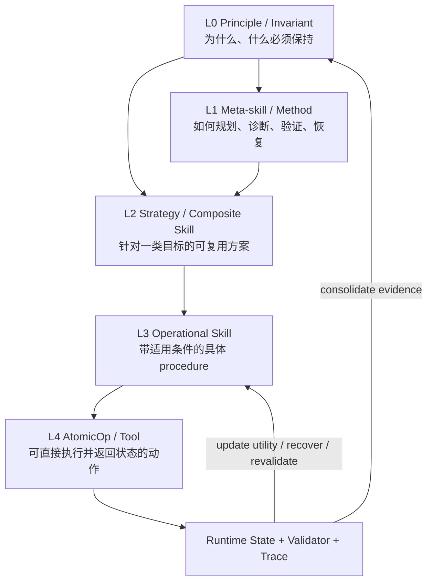

# 从 Skill Discovery 到 Skill Management：两篇机器人 Agent 论文总结与技能组织研究

> 更新日期：2026-08-11  
> 核心问题：skill 是否是在补足 post-training？现有系统怎样组织、检索、组合和维护 skills？Aspire 之后还缺什么？hierarchical / weighted skill 是否值得做？

## 0. 结论先行

1. **Skill 可以补足 post-training，但不能被等同为“给 post-training 打补丁”。** 更准确地说，skill 是一种位于模型参数之外、在 inference time 按需加载的**外部程序性知识（procedural memory）与工作流约束**。它可以补充模型没有学到、没有稳定学会、已经过时，或只属于某个组织/环境的知识；但它也承担标准化流程、连接工具、复用资源、审计和治理等职责。它改变的是 agent 的 context 与 execution harness，而不是模型权重。

2. **目前没有一个被公认、统一且成熟的“技能操作系统”范式。** 已经形成的工程基线是 Agent Skills 的“metadata discovery -> activation -> on-demand resources”渐进式披露；2026 年研究前沿则正在把它扩展为“taxonomy / retrieval + typed graph orchestration + lifelong evolution + library maintenance”。这是一个正在收敛中的范式，而不是已解决的问题。

3. **你对 Aspire 的判断基本准确，而且论文自己承认这一点。** Aspire 很强地解决了 embodied failure attribution、validated skill discovery 和跨任务积累；但其技能库仍是以紧凑文本条目为主，长期的 retrieval、ranking、deduplication、pruning、re-validation 和 stale skill 管理尚未解决。Aspire 的 limitation 明确指出，库变大后会出现过时、过专、冗余或误导条目，并可能造成 zero-shot transfer 的非单调变化。[Aspire 论文与项目页](https://research.nvidia.com/labs/gear/aspire/)

4. **Hierarchy 和 weighting 不是二选一，而是两个正交维度。**

   - hierarchy / typed graph 回答：技能之间是什么关系、怎样分解、怎样组合、失败后切到哪里；
   - weight / utility model 回答：在当前任务、状态、风险和成本下，哪条可行路径更值得选。

5. **“技能更像行为模板，而不是行为理论”这个观察抓到了现有 skill 的主要缺陷。** 但需要再精确一点：skill 可以容纳原则和解释，问题在于多数现有系统把它实现成扁平、局部、程序性的文本或代码。因此建议在 skill 之上增加 **principle / invariant 层**，在其下保留 strategy、skill 和 AtomicOp，并用可验证的压缩准则从相似 skills 中提炼原则。

6. **最值得研究的系统不是“树状技能库”，而是 `Principle-guided Weighted Hierarchical Skill Graph`。** 它应同时具备：typed contracts、typed relations、contextual utility、验证器、版本/来源、负例、维护闭环，以及从多个具体 skill 中抽象公共原则的 consolidation 机制。

---

## 1. 两篇论文分别在解决什么问题

| 论文 | 核心问题 | 主要答案 | 没有解决的部分 |
|---|---|---|---|
| **ASPIRE: Agentic /Skills Discovery for Robotics** | 机器人 code-as-policy agent 只有粗粒度成功/失败反馈，难以定位 perception、grasp、planning、contact 或 long-horizon coordination 中的根因；不同任务的修复经验不会积累；单轨迹 debug 容易陷入局部修补 | primitive-level multimodal traces + validated repair skill library + evolutionary program search + coordinator/actor continual-learning loop | 大规模 skill 检索、排序、去重、冲突处理、时效性、重验证和长期治理；技能仍受预定义 robot API 限制；真实世界自动 reset/verification 尚未闭环 |
| **Agentic AI for Robot Control: Flexible but still Fragile** | 怎样让 reasoning LLM 在 partial observability、sensor noise、state staleness、exogenous events 下通过已有 robot skills 完成真实任务，同时保持可解释与跨平台迁移 | 模块化 prompt + planner/executor loop + semantic state snapshot + constrained action API + structured feedback + event polling + goal-completion critic | 行为仍非确定、对 prompt 敏感、偶尔不遵守约束；事件只能 polling，长动作不可抢占；依赖已有原子 skills，不学习新低层能力；验证主要是 proof of concept 而非系统量化评估 |

两篇论文可以放在同一条技术链上理解：

- 第二篇重点研究 **“已有 skills 时，LLM 如何 plan / execute / monitor / recover”**；
- Aspire 进一步研究 **“执行失败后，如何发现新修复知识，并让经验跨任务累积”**；
- 你的问题继续向前一步：**“技能越来越多之后，怎样形成结构、选择、组合、抽象和维护机制”**。

---

## 2. Aspire：问题、设计模块与关键思想

来源：[arXiv:2607.00272](https://arxiv.org/abs/2607.00272)、[NVIDIA 项目页](https://research.nvidia.com/labs/gear/aspire/)、本地 `Aspire.pdf`。

### 2.1 它试图 settle 的问题

Aspire 针对三个紧密关联的瓶颈：

1. **Failure attribution 不足**：仅知道整条 rollout 失败，无法区分是目标检测错误、抓取不稳定、IK 不可达、规划碰撞，还是后续恢复失败。
2. **Experience 不累积**：第 100 个任务仍像第 1 个任务一样从头调试；成功修复在任务结束后被丢弃。
3. **Search 过于局部**：单条 write-execute-debug 轨迹容易围绕同一种错误方案反复 patch，缺少策略多样性。

Aspire 的核心主张不是“训练出一个更强的机器人 policy”，而是把软件工程 agent 的 **inspect -> diagnose -> patch -> execute -> validate -> retain** 循环迁移到机器人 code-as-policy。

### 2.2 设计模块一：Robot Execution Engine

**作用**：把 task-level reward 转换为可定位根因的 primitive-level multimodal evidence。

记录内容包括：

- perception / planning / grasp / control API 的输入、输出与 return status；
- 调用前后的 RGB keyframes，而不是无差别塞入全视频；
- segmentation overlay、grasp candidates、object poses；
- motion plan、collision feedback、IK / planning errors。

**关键思想**：

- 这是一种面向 agent debugging 的 observability 设计，类似软件系统中的 structured tracing；
- 证据围绕 primitive call 对齐，使 agent 能沿因果链定位失败，而不是根据最终失败结果猜测；
- 修复必须重新执行并验证，避免把 plausible explanation 误当成有效知识。

论文案例中，机器人已经正确找到 radio，但多次接近目标时触发 `PLANNING_ERROR`。trace 显示目标 pose 落入桌边 collision buffer，因此修复不是换 perception prompt 或 grasp primitive，而是采样多个 approach angle。这一修复随后被提炼为 **Multi-Angle Approach** skill。

### 2.3 设计模块二：Skill Library

**作用**：把已验证修复从 task-specific program 中提取出来，形成未来任务可按需读取的 in-context guidance。

每个技能条目主要包含：

- failure signature / problem；
- when-to-apply guard；
- repair strategy；
- 必要时附 representative code sketch；
- provenance / origin tasks 与验证证据。

技能内容是异构的，包括 localization heuristics、perception prompts、grasp constraints、navigation recovery、motion primitives、scene reasoning 和 debugging workflows。Aspire 声称不预先固定 taxonomy，而是由已验证修复逐步归纳出来。

**Admission 机制**：actor 输出结构化 findings；coordinator 检查 API 合规性、可复用性和 debug validation，只把通过验证且可能迁移的模式写入共享库。协调器串行化 library write，actors 不共享完整聊天记录和原始 trajectory，从而控制上下文大小。

**关键思想**：

- 保存的不是完整任务程序，而是跨任务可复用的最小修复模式；
- skill 充当非参数化的 procedural memory；
- failure-derived knowledge 比只记 successful trajectory 更包含边界条件和恢复信息；
- skill 作为 in-context guidance，可以跨 embodiment 迁移，而不是直接部署同一个底层 policy。

### 2.4 设计模块三：Evolutionary Search over Programs

**作用**：避免单轨迹调试陷入局部最优。

流程是：

1. 在 skill library、当前任务、top previous programs 和 residual failure traces 条件下产生 `K` 个候选程序；
2. 在 debug seeds 上执行所有候选并记录分数与 traces；
3. 保留表现较好的候选，并基于其剩余失败生成下一代；
4. 达到阈值或耗尽预算后，在 held-out validation seeds 上复验；
5. 从搜索历史和最终程序中提取 validated patterns，再考虑写入 skill library。

**关键思想**：

- 搜索对象是 executable robot program，而不是纯文本 thought；
- selection 由闭环执行结果决定；
- population 保留多种 repair hypothesis；
- debug set 和 validation set 分开，降低把一次成功过拟合成 skill 的风险。

### 2.5 设计模块四：Coordinator-Actor Continual Loop

**作用**：并行探索多个任务，同时把共享经验压缩到统一库中。

- coordinator：调度任务、维护技能库、审计 findings；
- actor：面向单任务写代码、执行、定位、修复和验证；
- shared library：是 actors 之间主要的知识传递通道；
- persistent memory / skill index：给后续 actor 提供渐进式入口。

这种设计实际上把“跨任务学习”从模型参数更新转换为“受控的外部知识库演化”。

### 2.6 结果与证据强度

- 在 LIBERO-Pro、Robosuite、BEHAVIOR-1K 上，相比相应强基线取得明显提升；论文报告 execution engine 使 macro-average success 从 14% 提升到 62%，再加入 evolutionary search 达到 72%。
- LIBERO-90 累积出的技能库在 LIBERO-Pro Long 上进行无额外 debug 的 zero-shot transfer，position / task perturbation 分别达到 23% / 38%，平均约 31%；随着 source library 从 0 增至 90，整体趋势改善。
- 三个 sim-to-real 案例中，skills 降低了首次成功所需 token；例如 soda-can lifting 从 13/20 提升到 19/20，drawer 从 0/20 提升到 11/20。

这些结果支持“validated repair memory 能迁移”，但不能推出技能管理已经解决。其真实机器人实验只有三个选择性技能，且真实世界 reset、success checking、安全监控和 calibration maintenance 仍需要人工或额外系统。

### 2.7 Aspire 的真正边界

Aspire 明确列出：

- 依赖 frontier LLM 和很长 context，弱模型能否维持同样 loop 未验证；
- 行为空间受预定义 perception / planning / control API 限制；
- 大量 LLM calls 与 simulator / robot rollouts，成本高；
- **skill library 没有完整的 long-term memory management**：stale、specific、redundant、misleading entries 会累积，需要 retrieval、pruning、ranking、re-validation。

因此更准确的评价是：

> Aspire 主要完成了“从可归因失败中发现、验证、保存技能”的闭环，并给出有限规模下的迁移证据；它没有完成大规模技能生态的组织、选择、组合与治理闭环。

---

## 3. Agentic AI for Robot Control：问题、设计模块与关键思想

来源：[arXiv:2602.13081](https://arxiv.org/abs/2602.13081)、本地 `2602.13081v1.pdf`。

### 3.1 它试图 settle 的问题

论文关注：在真实机器人已有导航、感知、抓取、放置等底层能力的前提下，能否让 reasoning LLM 通过自然语言目标完成 iterative planning and acting，并应对：

- partial observability 与 stale state；
- sensor noise 和 intermittent failure；
- ambiguous instruction；
- emergency stop、低电量、用户改口等 exogenous events；
- 跨机器人、跨 domain 复用同一个 high-level agent loop。

论文标题中的结论很重要：**架构很 flexible，但 agent policy 仍 fragile**。它不是宣称问题已彻底解决，而是给出一个可迁移工程骨架，并系统暴露 failure modes。

### 3.2 设计模块一：Router 与 Chatbot 分流

- router 判断 utterance 是 conversational 还是 actionable；
- conversational 请求交给 chatbot；
- actionable 请求交给 planner and executor。

这个拆分降低了控制 agent 被闲聊占用或误触发动作的概率，但 router 本身仍是模型判断，不是形式化安全证明。

### 3.3 设计模块二：Planner and Executor 单循环

一个 reasoning LLM 在统一 loop 中交替进行：

1. natural-language plan / reflection；
2. state acquisition；
3. exactly one grounded action；
4. result / event monitoring；
5. consistency checking 与 replanning。

作者有意让 LLM 只在**高层语义状态与参数化原子技能**上推理，把 geometry、mapping、localization、motion planning、IK 和 trajectory execution 留给现有 robot stack。

这是一种明确的 abstraction boundary：LLM 负责 uncertain deliberation，传统 robotics stack 负责可执行低层控制。

### 3.4 设计模块三：模块化 Prompt / Domain Model

planner prompt 分成八类：

1. natural-language domain model；
2. example semantic state；
3. operational instructions；
4. object / action affordances；
5. domain-specific heuristics；
6. action catalogue；
7. planning and acting exemplars；
8. prior failure reminders。

其中包含 embodiment、reachability、observable predicates、必须重观察的状态、安全 invariants、别名解析和 ambiguity handling。

**迁移思想**：跨平台时主要替换 domain model、affordances、action catalogue 和 API binding，其余 interaction loop 与安全规则可以保留。论文称把 indoor Mobipick 架构适配到 outdoor Valdemar simulation 约用一天，但这是工程案例，不应解读为普遍的“一天迁移保证”。

### 3.5 设计模块四：最小 Tool Interface

planner and executor 只看到四类接口：

- `reflect`：输出结构化 introspection，不改变环境；
- `act`：执行恰好一个高层动作；
- `get_semantic_environment_representation_snapshot`：获取当前部分可观测状态；
- `check_events`：查询上次检查后发生的离散文本事件。

`act` 再映射到 `navigate / move_arm / perceive / pick / place / insert / listen / speak` 等 robot-specific skills。每个 skill 通过 docstring 描述参数、主要 preconditions / effects，并返回 success、failure 或 concise error trace。

**关键思想**：限制 action surface 可以减少 invalid action 和低层幻觉；structured return 为 replanning 提供 grounded evidence。

### 3.6 设计模块五：Semantic State Snapshot

Mobipick 将 buffered perception 转换为 `at(robot, location)`、`on(object, table)`、`in(object, box)` 等离散 predicates；Valdemar 则把 geoposition 映射为已知地点，并将 battery 离散为 `okay / low / critical`。

**思想**：用简单、跨平台的符号状态统一不同传感器和控制栈，使 LLM 不必直接处理原始 geometry。但 snapshot 会过时，且离散化会损失信息，因此必须反复 sensing 和 consistency check。

### 3.7 设计模块六：Goal Completion Critic

论文观察到 planner 有时只解释“应该怎样做”，却不执行任何环境改变动作。critic 读取原始 goal 和 execution log，区分：

- genuine physical attempt；
- verbal-only superficial completion；
- infeasible、重复物理失败、缺少用户授权等应停止情形。

critic 可以要求 planner 继续，但不会无限推动不合理重试。这是 runtime verification 的雏形，但它仍是另一个 LLM，并非形式化 validator。

### 3.8 实验说明了什么

论文在 Mobipick 与 Valdemar 上展示：

- 部分可观测条件下的搜索、抓取、放置与容器利用；
- 对 ambiguous command、emergency stop、用户偏好更新的适应；
- 低电量时中断、回充、恢复任务；
- 对明显不可能指令的拒绝；
- 同一 loop 跨 indoor manipulation 与 outdoor navigation/sensing 的迁移。

但实验也暴露：

- 偶尔使用 stale perception 进行 risky placement；
- prompt 中的 affordance 会被 commonsense preference 覆盖；
- 同一模糊目标的充电终点不稳定；
- 即使拒绝不可能任务，也可能推荐同样不可行的替代行为；
- `check_events` 调用不规律或连续重复；
- event detection 是同步 polling，只能在动作之间介入，长动作不可 preempt；
- 安全约束常需在 prompt 多处重复，仍可能偶发违反；
- 远程 LLM 带来 latency、cost 与 connectivity 依赖。

因此它证明的是架构可行性和迁移潜力，而不是鲁棒控制已经被 LLM planning 解决。

---

## 4. Skill 是否是对 post-training 不足的补充和规范？

### 4.1 简短回答

**是，但只说对了一部分。**

Agent Skills 开放规范把 skill 定义为包含 `SKILL.md`，并可携带 scripts、references、assets 的目录。agent 先看到 name + description，匹配任务后加载完整 instructions，再按需读取资源；这是一种三阶段 progressive disclosure。[Agent Skills 规范](https://agentskills.io/specification)

因此 skill 的本质更接近：

> 模型参数之外、可发现、可版本化、可按需注入、可连接执行资源的程序性知识单元。

### 4.2 它和训练阶段的关系

| 层 | 主要提供什么 | 变化速度 | 典型局限 |
|---|---|---|---|
| Pre-training | 世界知识、语言与一般模式 | 很慢 | 知识有截止时间；未必学到特定组织流程 |
| Post-training | 指令遵循、偏好、安全、工具使用等通用行为策略 | 慢 | 很难覆盖所有 domain、工具版本、团队规范和长尾 edge cases |
| Skill | task/domain-specific procedure、规范、模板、脚本、验证流程 | 快，可局部更新 | 受检索、上下文、描述质量、冲突和 stale knowledge 影响 |
| Tool / API | 对外界产生真实效果的 capability | 由系统决定 | skill 不能凭空创造不存在的 actuator、permission 或 API |
| Runtime feedback | 当前状态、错误、验证结果 | 最快 | 噪声、partial observability、归因错误 |

所以 skill 确实能补足以下 post-training 缺口：

- 模型未见过或没有稳定内化的工作流；
- 快速变化的工具、API、组织规则；
- 稀有但高风险的 edge cases；
- 需要显式步骤、模板、资源与验证器的任务；
- 需要审计、版本控制和跨模型复用的 procedure。

但 skill 也有 post-training 之外的价值：

- 把团队偏好和治理规范显式化；
- 让行为可审计、可编辑、可回滚；
- 绑定 scripts / assets，减少模型重新发明确定性操作；
- 将多个模型共享的知识放在统一外部层；
- 形成持续学习的非参数 memory。

Voyager 已展示“不更新模型参数，而通过自动 curriculum、可执行 skill library 和 iterative feedback 实现 in-context lifelong learning”的路线，这说明 skill 不仅是对齐补丁，也是 alternative learning substrate。[Voyager](https://arxiv.org/abs/2305.16291)

### 4.3 Skill 能补什么，不能补什么

Skill 可以提高**可靠性概率**，但不能保证模型会无条件遵循；第二篇论文中 event checking 规则在多次 prompt intervention 后仍不稳定，就是反例。

Skill 也不能：

- 赋予系统不存在的 perception / control primitive；
- 自动保证 factual correctness 或 physical safety；
- 替代 runtime state、validator 和 feedback；
- 消除模型能力下限。Aspire 也没有验证较弱模型能否完成同样的 trace diagnosis 和 repair。

因此可靠 agent 更像：

`Model priors + Skills + Tools + State + Validators + Runtime feedback + Governance`

而不是 `Model + 更多 prompt`。

---

## 5. 现行的技能组织 paradigm：已有答案与仍缺的部分

### 5.1 工程基线：Progressive Disclosure

Agent Skills 当前标准方案是：

1. **Discovery**：会话开始只暴露所有 skill 的 name / description；
2. **Activation**：相关时加载完整 `SKILL.md`；
3. **Execution / Resources**：只在需要时加载 scripts、references、assets。

它高效解决了“不要把所有技能全文塞进 context”的问题，却没有规定：

- 多个 skill 如何组合；
- dependency 与 compatibility 如何表达；
- 冲突时选谁；
- 如何根据成功率、成本、风险动态排序；
- 如何合并重复 skill；
- 如何让 skill 过期、重验证和退役。

所以 progressive disclosure 是必要的 context organization pattern，不是完整的 skill management paradigm。

### 5.2 检索层：Taxonomy + Hybrid Retrieval + Reranking

2026 年的 [SkillRet](https://arxiv.org/abs/2605.05726) 从 22,795 个公开条目中过滤得到 17,810 个 skills，并构建 6 个大类、18 个子类的两级 taxonomy。其结果表明，off-the-shelf retrieval 在真实大规模 skill library 上仍远未解决；针对 skill retrieval 的训练使 NDCG@10 相比最强 prior retriever 提升 13.1 points。

这说明仅依赖 `description` 和 embedding top-k 不够，尤其当：

- query 很长，但真正决定 skill 的信号很短；
- 一个任务需要多个 skill；
- 类别分布长尾且严重不均衡；
- skills 文档长、内容组合性强。

### 5.3 组织层：Ontology / Graph，而不是 Flat Folder

[SkillNet](https://arxiv.org/abs/2603.04448) 把 skills 组织进统一 ontology，并从 Safety、Completeness、Executability、Maintainability、Cost-awareness 多维评估；它代表“skill 作为 evolving, composable asset”的方向。

[Graph of Skills](https://arxiv.org/abs/2604.05333) 进一步指出，简单向量检索会遗漏 execution dependency；其 offline skill graph + semantic/lexical seeds + Personalized PageRank + context-budgeted hydration，在 200 到 2,000 个 skills 的实验中改善 reward / token trade-off。

[Group of Skills](https://arxiv.org/abs/2605.06978) 则把 agent-facing retrieval object 从 flat list 改为有角色的 execution context：`Start / Support / Check / Avoid`。这很接近“行为方法 + 支持条件 + 验证 + 负例”的结构化表达。

### 5.4 执行层：Hierarchical Skill Graph

2026 年 7 月的 [HiSkill](https://arxiv.org/abs/2607.25853) 与你的 hierarchy 想法高度重合。它区分：

- high-level skill nodes；
- executable `AtomicOp` nodes；
- `decomposes_to`；
- `can_follow`；
- `compatible_with`；
- `supports`；
- `recovers_with`。

运行时先用 dense semantic + BM25 lexical score 找 seed nodes，再进行一跳 graph hydration，得到 compact task-relevant subgraph；随后维护 symbolic task state 和 active skill，在完成、缺前置条件或失败时进行 skill switching / support / recovery。论文报告相对最强 baseline 的平均 success rate 提升 17.33%，同时 inference tokens 减少 78.75%。这是最新 preprint 的实验结果，仍需后续独立复现，但它清楚表明 hierarchy 已成为显式研究方向。

### 5.5 演化层：Lifelong Skill Discovery 并不自动带来收益

[SkillFlow benchmark](https://arxiv.org/abs/2604.17308) 让 agent 从空库开始，按 task family 顺序执行，并依据 trajectory 与 rubric feedback 持续 patch skills。结果非常关键：

- Claude Opus 4.6 从 62.65% 提升到 71.08%；
- 但 Kimi K2.5 有 66.87% skill usage，收益只有 0.60 points；
- 某些模型在 skill 累积后反而退化；
- 主要差异不是“会不会写 skill”，而是能否识别并修复 bad skill；
- uncontrolled skill inflation、overlapping entries 和早期错误会造成 persistent negative transfer。

因此“用了 skill”不等于“skill 有用”，library size 也不是能力的充分指标。

### 5.6 维护层：SkillOps

[SkillOps](https://arxiv.org/abs/2605.13716) 直接研究 Aspire 尚未完整覆盖的问题。它把每个 skill 表示为 typed contract：

`(P, O, A, V, F) = (Precondition, Operation, Artifact, Validator, Failure mode)`

并建立两层 Hierarchical Skill Ecosystem Graph：

- internal contract graph；
- skill 间的 dependency、compatibility、redundancy、alternative graph。

系统分别运行：

- task-time loop：match、stitch dependency、插入 adapter / validator、local repair；
- library-time loop：根据 utility、redundancy、compatibility、failure risk、validation gap 做 merge、repair、retire、add-validator、add-adapter、instantiate。

这正是“技能库应该像软件生态一样持续维护”的范式。当前实现有较多 rule-based 假设，且不同 agent 类型上收益并不一致，所以它是很强的研究起点，不是最终答案。

### 5.7 对“是否存在现行 paradigm”的最终回答

最准确的表述是：

> 已经出现一个分层的 emerging paradigm：**Skill Packaging -> Progressive Discovery -> Hybrid Retrieval -> Graph-based Composition -> Runtime Validation -> Lifelong Update -> Library-time Maintenance**。但还没有像数据库关系模型或 ROS action interface 那样形成统一、成熟、跨系统验证的标准。

传统领域也提供了可借鉴的理论祖先：

- HTN planning：把 compound task 分解为 subtask；[HTN overview](https://arxiv.org/abs/1403.7426)
- hierarchical RL / MAXQ：把任务和值函数分解，并复用 subtask；[MAXQ](https://arxiv.org/abs/cs/9905014)
- Behavior Trees：用层级结构组织 reactive switching，提高模块性；[Behavior Trees survey](https://arxiv.org/abs/2005.05842)

LLM skill 系统的新部分在于：技能可能是自然语言、代码、资源和工具绑定的混合 artifact，关系和适用条件往往要从 trajectories 自动归纳，而且库本身会由 agent 修改。

---

## 6. 对你的 hierarchy / weighted skill 想法的完善

### 6.1 为什么纯树不够

严格 hierarchy tree 有三个问题：

1. 一个 skill 可能同时属于多个抽象父类，例如 `multi-angle approach` 同时属于 navigation、collision recovery、viewpoint planning；
2. 技能之间有 cross-cutting dependency、alternative、compatibility 和 recovery，不是单一 parent-child；
3. 同一个 high-level task 在不同 embodiment 上可能映射到不同 AtomicOps。

因此建议保留层级语义，但实现为 **typed DAG / graph**。

### 6.2 建议的五层结构



各层含义：

- **L0 Principle / Invariant**：跨多个技能的因果原则、安全约束、选择准则。例如“状态在移动和人类干预后会 stale，依赖它之前必须重观察”。
- **L1 Meta-skill / Method**：与具体 domain 弱相关的行为方法，如 trace-guided diagnosis、hypothesis diversification、held-out validation、rollback。
- **L2 Strategy / Composite Skill**：可分解的高层方案，如 safe transport、search-then-grasp、battery-aware巡检。
- **L3 Operational Skill**：明确 when-to-apply、步骤和恢复策略的程序性模板，如 multi-angle approach。
- **L4 AtomicOp / Tool**：可直接执行的 API / action template，如 `navigate_to_pose`、`sample_grasp_pose`。

这补上了你所说的“理论/思想”层，同时保持技能最终可执行。

### 6.3 Skill Contract：每个 skill 不应只有说明文字

建议最小 schema：

```yaml
id: navigation.multi-angle-approach
version: 3
status: validated  # candidate | validated | deprecated | blocked
level: operational-skill
goal: reach a graspable pose near an object
principles:
  - collision-feasibility-before-shortest-path
preconditions:
  - object_pose_available
  - repeated_planning_error_near_obstacle
contraindications:
  - object_pose_confidence_below_threshold
operation:
  procedure: sample rotated approach vectors and retry
requires:
  - perceive.object-pose
  - navigate.to-pose
produces:
  - reachable_approach_pose
relations:
  recovers_with: [navigation.backtrack-and-reobserve]
  alternatives: [navigation.waypoint-hopping]
validator:
  - distance_to_object < 0.8
  - no_collision
failure_modes:
  - all sampled poses infeasible
evidence:
  successes: 31
  failures: 7
  task_families: [radio-pickup, cabinet-approach]
  embodiments: [tiago-sim, yam-real]
  last_validated: 2026-07-30
cost:
  expected_steps: 3.4
  expected_tokens: 820
provenance:
  source_tasks: [behavior-radio-12, libero-goal-04]
```

关键是把“什么时候不能用”“怎样验证”“证据来自哪里”与正向 procedure 同等对待。

### 6.4 Weighted 机制：不要给 skill 一个全局分数

同一个 skill 在不同 task、state、embodiment 下效用不同，因此应估计 context-conditioned utility：

\[
\begin{aligned}
Score(s\mid x) ={}& w_r Rel(s,x) + w_a App(s,x) + w_u Util(s,x) \\
&+ w_t Transfer(s,x) + w_f Fresh(s) + w_c Compat(s,G_x) \\
&- w_k Cost(s,x) - w_q Risk(s,x) - w_d Redundancy(s,G_x)
\end{aligned}
\]

其中：

- `Rel`：semantic + lexical relevance；
- `App`：当前 state 是否满足 applicability；
- `Util`：相似 context 中的 empirical success posterior；
- `Transfer`：跨 task / embodiment 的历史迁移表现；
- `Fresh`：距最后验证时间与 dependency version drift；
- `Compat`：与已选 skill、输入输出类型和 task subgraph 的兼容性；
- `Cost`：tokens、latency、动作数、robot rollout cost；
- `Risk`：失败严重度与不确定性；
- `Redundancy`：与已选技能的重复程度。

执行时应遵守两阶段原则：

1. **Hard gate**：preconditions、安全 invariant、权限、API availability 不满足时直接排除；
2. **Soft ranking**：只在可行候选中使用权重排序或搜索。

安全约束不应因“预期成功率高”而被加权抵消。

`Util(s,x)` 可以从分 context 的 Beta-Bernoulli posterior 起步，并对旧证据做时间衰减；更复杂时可将 selection 视为 contextual bandit。但在线更新必须保留 failure severity，不能把一次危险失败与一次普通失败等价计数。

### 6.5 Hierarchy 与 Weight 怎样一起工作

推荐 runtime：

1. 从 task + initial state 提取 goal、constraints、entities；
2. 检索少量相关 principles 和 strategy nodes；
3. 沿 typed edges hydration，加入 required、support、validator、recovery 和 AtomicOps；
4. 对整个 candidate subgraph 做 hard constraint check；
5. 以 context-dependent weights 搜索一条或数条 execution plan，而不是选单个 top-1 skill；
6. 每步执行后更新 symbolic state、active skill 和 posterior；
7. failure 时优先沿 `recovers_with`，证据冲突时回退到 re-observation / replanning；
8. task 后写 trajectory evidence，不立即把每次经验都生成为新 skill；由 library-time consolidation 决定 patch、merge、specialize 或 retire。

---

## 7. 从相似 skills 提炼“指导思想”：把压缩变成可验证机制

### 7.1 “智能就是压缩”应该怎样使用

“预测与压缩等价”有坚实的信息论背景；语言模型也可以被视为预测器/压缩器。[Language Modeling Is Compression](https://arxiv.org/abs/2309.10668) 进一步展示了 foundation model 的通用压缩能力。[MDL-Control](https://arxiv.org/abs/2207.08258) 则在 multitask RL 中用 Minimum Description Length 提炼跨任务公共结构，以促进新任务收敛和泛化。

但“智能就是压缩”在这里应该被当作**设计原则和 objective**，而不是无需验证的等式。错误压缩会删掉 applicability guard、exception 和 causal distinction，导致 negative transfer。

### 7.2 可操作的 Principle Distillation 目标

对于一组相似 skills `S = {s1, ..., sn}`，寻找一个 principle `p` 和每个 skill 的 specialization / adapter `δi`：

\[
p^*, \{\delta_i^*\} = \arg\min \left[
L(p) + \sum_i L(s_i \mid p, \delta_i) + \lambda E_{heldout} + \mu C_{risk}
\right]
\]

- `L(p)`：公共原则自身的描述长度；
- `L(si | p, δi)`：在已有原则后表达具体 skill 还需多少信息；
- `E_heldout`：在 held-out tasks / seeds 上的性能损失；
- `C_risk`：丢失禁用条件、引入危险迁移的代价。

只有在以下条件同时满足时才 promote 为上层 principle：

- 总描述长度或 context tokens 实际减少；
- held-out success 不下降，或 sample efficiency 明显提高；
- applicability / contraindication 可判定；
- 至少覆盖多个 task families，而非同一任务的表面 paraphrase；
- 原始 skills 保留 provenance，可从 principle 回溯到证据；
- 失败时可降级回 specialization，不强制套用抽象原则。

### 7.3 一个具体例子

可能观察到三个 skills：

- navigation target 在桌边不可行时旋转 approach vector；
- grasp IK 不可达时改变 wrist orientation；
- view 被遮挡时移动到 alternate viewpoint 后重新 perceive。

不能简单压成“失败就换角度”。更好的 principle 是：

> 当目标语义不变、失败来自 configuration-space feasibility 时，应在保留 task constraint 的前提下搜索等价的 geometric realization，并在每次切换后重新验证依赖该 geometry 的下游状态。

它解释了**为什么**三个 skills 相似，也保留了适用边界。三个具体 skills 仍作为不同 specialization，分别绑定 navigation、IK、perception validator。

### 7.4 怎样自动产生候选 principle

可以组合：

- failure signature / precondition / state-transition 的 canonicalization；
- frequent subgraph / frequent sequence mining；
- action arguments 参数化，实体替换为 typed placeholders；
- 按成功/失败 trajectory 对比，提取产生 outcome difference 的最小结构；
- LLM 只负责命名、解释和提出候选 causal rule；
- simulator / held-out replay 负责验证；
- MDL + transfer utility 决定是否 merge、建立 parent，或保持独立。

2026 年的 [Unsupervised Hierarchical Skill Discovery](https://arxiv.org/abs/2601.23156) 已展示用 grammar-based 方法从无标签 trajectories 发现低层行为及其高层组合；HiSkill 则从成功轨迹的 frequent AtomicOp patterns 形成 skill，并从失败轨迹诱导 recovery edges。二者可以成为 principle distillation 的结构学习起点。

---

## 8. 一个可研究、可实现的系统方案

暂命名：**PWHSG - Principle-guided Weighted Hierarchical Skill Graph**。

### 8.1 离线 / library-time pipeline

1. **Ingest**：导入人工 skill、Aspire-style findings、successful / failed trajectories；
2. **Normalize**：把 operation、arguments、state predicates、failure signature 规范化；
3. **Contract extraction**：生成 `P/O/A/V/F` contract 与 provenance；
4. **Relation induction**：建立 `is_a / decomposes_to / requires / produces / can_follow / compatible / alternative / supports / recovers_with / contradicts`；
5. **Consolidation**：用 similarity + frequent subgraph + MDL 提议 merge / parent principle / specialization；
6. **Validation**：在 debug seeds、held-out seeds、跨 task / embodiment 上复验；
7. **Maintenance**：更新 utility、freshness、risk，执行 patch / merge / split / retire / revalidate；
8. **Indexing**：分别建立 principle、skill、AtomicOp 的 lexical / dense / graph index。

### 8.2 在线 / task-time pipeline

1. parse task and state；
2. retrieve principle + skill seeds；
3. hydrate bounded typed subgraph；
4. apply hard gates；
5. score candidate subgraphs；
6. plan and ground AtomicOps；
7. execute, monitor, validate；
8. switch / recover / ask human；
9. write evidence log，延迟到 library-time 再决定是否改库。

### 8.3 与 Aspire 的组合方式

Aspire 可以继续负责：

- multimodal trace production；
- failure attribution；
- candidate repair generation；
- program-level evolutionary exploration；
- debug / validation evidence。

PWHSG 增加：

- structured skill contract；
- multi-level abstraction；
- typed graph relations；
- context-conditioned retrieval / weighting；
- maintenance 和 principle consolidation；
- stale / redundant / conflicting skill governance。

即：Aspire 是 **skill discovery engine**，PWHSG 是 **skill organization, orchestration and lifecycle layer**。

---

## 9. 建议的研究问题、假设与实验

### RQ1：层级 / 图结构是否比 flat top-k 更有效？

**H1**：当任务需要多个相互依赖 skills 时，typed subgraph 比 flat vector retrieval 有更高 task success、更低 token cost 和更少 invalid composition。

对照：

- full library in context；
- BM25 top-k；
- dense top-k；
- hybrid top-k；
- flat skill list + LLM planning；
- hierarchy only；
- typed graph hydration。

### RQ2：contextual weighting 是否优于静态排名？

**H2**：按 task family、state、embodiment、freshness、risk 条件化的 posterior，比全局 success rate 或 embedding similarity 更能降低 negative transfer。

对照：

- relevance only；
- relevance + global success；
- relevance + contextual utility；
- full score；
- full score without hard gate。

最后一个消融尤其重要，可展示安全约束为何不能只做 soft weight。

### RQ3：principle distillation 是否真的产生“压缩后的智能”？

**H3**：MDL-guided principle + specialization 能在减少 context tokens 和 skill count 的同时，维持或提高 held-out transfer；naive LLM summarization 则更容易丢失 guard 并产生 negative transfer。

对照：

- no consolidation；
- embedding dedup；
- LLM summary merge；
- frequent-pattern hierarchy；
- MDL + held-out validation；
- MDL + validation + negative constraints。

### RQ4：library-time maintenance 是否解决 Aspire 的非单调增长？

**H4**：revalidation、freshness decay、merge/split/retire 能让性能随 library size 更稳定，减少 SkillFlow 所观察到的 skill inflation 和 bad-skill persistence。

### RQ5：原则能否跨 embodiment，具体 skills 留在本体内？

**H5**：高层 principle 的 transfer rate 高于具体 code snippet；采用 `principle -> embodiment adapter -> AtomicOp` 能减少真实机器人 debug rollouts。

### 9.1 指标不要只看 success rate

- task success / subgoal completion；
- zero-shot / few-shot transfer；
- negative transfer rate；
- retrieval Recall@k、NDCG@k、dependency coverage；
- invalid composition / unmet precondition rate；
- safety violation 与 severity-weighted failure；
- LLM input/output tokens、latency、robot rollouts；
- time / tokens to first success；
- skill count、redundancy、graph size、stale ratio；
- principle compression ratio；
- held-out reconstruction / specialization cost；
- calibration：predicted utility 与实际成功率是否一致；
- repairability：bad skill 被发现并修复所需任务数。

### 9.2 Stress tests

- library 从 10、100、1k 到 10k skills；
- 注入重复、冲突、过时和恶意 skill；
- 改 API version 或 embodiment；
- unseen task composition；
- observation noise / stale state；
- 把一个 early bad skill 放在 task family 前部，测 persistent impact；
- 预算受限：只允许固定 token / rollout / wall-clock。

---

## 10. 最终判断

你的原始想法可以整理成以下更强的论点：

> 当前 agent skill 主要是一种外部程序性知识与行为约束。它能补足 frozen model 与 post-training 在长尾知识、特定工具、组织流程和经验积累上的不足，但不能替代模型能力、工具能力、状态观测和验证。Aspire 解决了从 embodied failures 中发现和验证 reusable skills 的关键环节，却没有完整解决技能规模化后的组织、组合、选择和生命周期治理。下一步不应只做 flat skill retrieval，也不宜只做严格树结构；更合理的研究对象是带有 principle 层、typed contracts、typed graph relations、hard constraints、contextual weights 和 library-time maintenance 的分层技能生态。相似 skills 的公共指导思想可以通过 MDL / grammar / frequent-subgraph 方法提炼，但抽象必须由 held-out transfer、负例与安全验证约束，否则“压缩”会变成丢失边界条件的过度总结。

这不是一个已经被完全占满的想法。HiSkill、SkillOps、Graph of Skills、SkillFlow 等工作分别覆盖了 hierarchy、maintenance、retrieval 和 lifelong evolution，但把 **principle distillation + contextual weighting + typed hierarchical graph + embodied validation** 完整结合，并针对 Aspire-style robot repair library 做系统消融，仍是一个清晰且有价值的研究方向。

---

## 参考资料

### 主要论文

1. Lu et al. [ASPIRE: Agentic /Skills Discovery for Robotics](https://arxiv.org/abs/2607.00272), 2026.
2. Lima et al. [Agentic AI for Robot Control: Flexible but still Fragile](https://arxiv.org/abs/2602.13081), 2026.

### Skill 标准、发现、检索与管理

3. [Agent Skills Open Specification](https://agentskills.io/specification).
4. Wang et al. [Voyager: An Open-Ended Embodied Agent with Large Language Models](https://arxiv.org/abs/2305.16291), 2023.
5. Liang et al. [SkillNet: Create, Evaluate, and Connect AI Skills](https://arxiv.org/abs/2603.04448), 2026.
6. Li et al. [Graph of Skills: Dependency-Aware Structural Retrieval for Massive Agent Skills](https://arxiv.org/abs/2604.05333), 2026.
7. Zhang et al. [SkillFlow: Benchmarking Lifelong Skill Discovery and Evolution for Autonomous Agents](https://arxiv.org/abs/2604.17308), 2026.
8. Pu et al. [SkillOps: Managing LLM Agent Skill Libraries as Self-Maintaining Software Ecosystems](https://arxiv.org/abs/2605.13716), 2026.
9. Cho et al. [SkillRet: A Large-Scale Benchmark for Skill Retrieval in LLM Agents](https://arxiv.org/abs/2605.05726), 2026.
10. Zeng et al. [Group of Skills: Group-Structured Skill Retrieval for Agent Skill Libraries](https://arxiv.org/abs/2605.06978), 2026.
11. Hao et al. [HiSkill: Empowering LLM Agents with Hierarchical Skill Graphs](https://arxiv.org/abs/2607.25853), 2026.

### 层级、行为组织与压缩

12. Dietterich. [Hierarchical Reinforcement Learning with the MAXQ Value Function Decomposition](https://arxiv.org/abs/cs/9905014), 1999/2000.
13. Georgievski & Aiello. [An Overview of Hierarchical Task Network Planning](https://arxiv.org/abs/1403.7426), 2014.
14. Iovino et al. [A Survey of Behavior Trees in Robotics and AI](https://arxiv.org/abs/2005.05842), 2020.
15. Harvey et al. [Unsupervised Hierarchical Skill Discovery](https://arxiv.org/abs/2601.23156), 2026.
16. Moskovitz et al. [Minimum Description Length Control](https://arxiv.org/abs/2207.08258), 2022.
17. Deletang et al. [Language Modeling Is Compression](https://arxiv.org/abs/2309.10668), 2023.

> 注：2026 年的多项工作仍是较新的 arXiv preprints；本文把它们作为“截至 2026-08-11 的研究前沿证据”，不把单篇报告结果视为已经形成共识。
