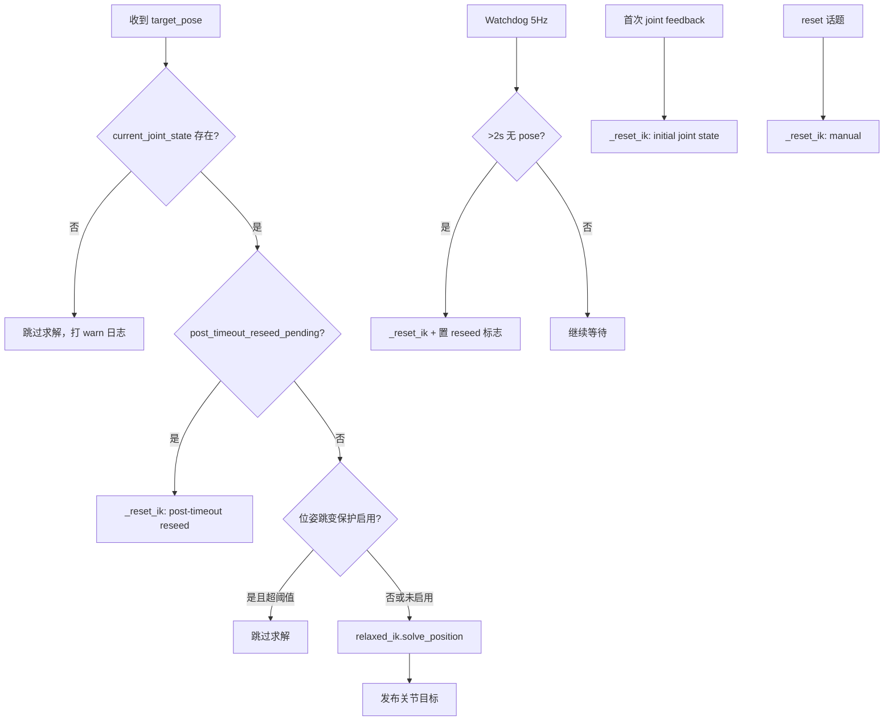

# Galaxea RelaxedIK — IK 保护机制说明

> 文档来源：`mobiman/lib/mobiman/relaxed_ik.py`（ROS 2 主版本）  
> 辅助参考：`mobiman/lib/mobiman/relaxed_ik_a1xy.py`（ROS 1 旧版）  
> 生成日期：2026-07-10

---

## 1. 概述

RelaxedIK 节点在接收末端目标位姿并求解逆运动学时，内置多层 **IK 保护** 逻辑，用于防止：

- 在关节反馈未就绪时盲目求解 IK
- 目标位姿与当前末端位姿相差过大导致突变（**位姿跳变保护**，当前默认注释未启用）
- 长时间未收到新的 pose 命令时 IK 内部状态漂移（**Watchdog 超时重置**）
- Reset 时使用不合理的 seed 导致求解失败

---

## 2. 相关源文件

| 文件 | 说明 |
|------|------|
| `galaxea/install/mobiman/lib/mobiman/relaxed_ik.py` | ROS 2 RelaxedIK 节点，含完整 watchdog / reset 保护 |
| `galaxea/install/mobiman/lib/mobiman/relaxed_ik_a1xy.py` | ROS 1 旧版，仅含 `protected_value` 位姿跳变保护（注释状态） |

启动脚本（按机型选择）位于：

```
startup_config/script/boot/modules/mobiman/start_*_relaxed_ik.sh
startup_config/script/boot/modules/mobiman/start_mobiman_r1*_ik_*.sh
```

---

## 3. 保护机制一览

| 机制 | 状态 | 关键参数 | 触发条件 |
|------|------|----------|----------|
| 关节反馈就绪检查 | **启用** | — | `current_joint_state is None` 时跳过 IK |
| 位姿跳变保护 | **注释/未启用** | `protected_value = 0.3` (m) | 目标位置距当前 EE 超过阈值则拒绝求解 |
| Watchdog 超时重置 | **启用** | 超时 `2.0` s，轮询 `0.2` s (5 Hz) | 超过 2s 未收到 pose 命令 |
| 超时后 Reseed | **启用** | — | watchdog reset 后，下一条 pose 到来时再次 reset |
| 首次关节反馈 Reset | **启用** | — | 第一次收到 `/hdas/feedback_arm_*` 时 reset |
| 外部 Reset 话题 | **启用** | — | 收到 `/relaxed_ik/reset_{left\|right\|normal}` |
| Reset Seed 优先级 | **启用** | — | input_seed → 当前关节 → last_pos → 默认 seed |

---

## 4. 关键 ROS 话题

### 4.1 输入（左臂示例，右臂对称）

| 话题 | 类型 | 作用 |
|------|------|------|
| `/motion_target/target_pose_arm_left` | `PoseStamped` | IK 目标位姿输入 |
| `/hdas/feedback_arm_left` | `JointState` | 当前关节反馈，用于 FK 与 seed |
| `/relaxed_ik/reset_left` | `JointState` | 外部手动 reset，position 可作为 seed |

### 4.2 输出

| 话题 | 类型 | 作用 |
|------|------|------|
| `/motion_target/target_joint_state_arm_left` | `JointState` | IK 求解结果（关节目标） |
| `/relaxed_ik/motion_control/pose_ee_arm_left` | `PoseStamped` | 当前末端 FK 位姿 |
| `relaxed_ik/joint_angle_solutions_left` | `JointState` | 求解关节角及误差统计 |

---

## 5. 机制详解与原始代码

### 5.1 位姿跳变保护（protected_value）

**目的**：若新目标位置与当前末端位置欧氏距离超过 `0.3 m`，则拒绝本次 IK 求解，避免大幅跳变。

**当前状态**：代码存在但 **被注释**，默认不生效。

```python
self.protected_value = 0.3

# pose_callback 内：
# if self.list_norm(positions, [
#         self.current_pose_msg.pose.position.x,
#         self.current_pose_msg.pose.position.y,
#         self.current_pose_msg.pose.position.z
#     ]) > self.protected_value:
#     print("input far from current position!\n")
#     return
```

`list_norm(a, b)` 即三维欧氏距离：

```python
dist = np.linalg.norm([
    msg.pose.position.x - self.current_pose_msg.pose.position.x,
    msg.pose.position.y - self.current_pose_msg.pose.position.y,
    msg.pose.position.z - self.current_pose_msg.pose.position.z,
])
# dist > 0.3 则拒绝
```

**启用方法**：取消上述注释，并确保 `fk_callback` 已更新 `current_pose_msg`。

---

### 5.2 关节反馈就绪检查

**目的**：在尚未收到关节反馈前，不进行 IK 求解。

```python
if self.current_joint_state is None:
    self.get_logger().warn("[pose_callback] current_joint_state is None; skip solving.")
    return
```

---

### 5.3 Watchdog 超时重置

**目的**：若超过 2 秒未收到新的 pose 命令，自动 reset IK 求解器，防止内部状态过期。

**初始化状态变量**：

```python
self.last_pose_msg_time = self.get_clock().now()
self._timeout_reset_done = False
self._post_timeout_reseed_pending = False
self.create_timer(0.2, self._watchdog_timer_cb)  # 5 Hz
```

**Watchdog 回调**：

```python
def _watchdog_timer_cb(self):
    now = self.get_clock().now()
    dt = (now - self.last_pose_msg_time).nanoseconds * 1e-9
    if dt > 2.0 and not self._timeout_reset_done:
        self._reset_ik(f"pose timeout {dt:.2f}s > 2.0s")
        self._timeout_reset_done = True
        self._post_timeout_reseed_pending = True
```

**pose 回调中更新时间戳并处理 reseed**：

```python
def pose_callback(self, msg):
    self.last_pose_msg_time = self.get_clock().now()
    # ...
    self._timeout_reset_done = False
    if self._post_timeout_reseed_pending:
        self._reset_ik('post-timeout pose reseed')
        self._post_timeout_reseed_pending = False
```

**状态流转**：

```
正常接收 pose
    ↓
超过 2s 无 pose → watchdog 触发 _reset_ik，置 _timeout_reset_done=True
    ↓
下一条 pose 到来 → 先执行 post-timeout reseed，再正常求解
    ↓
_timeout_reset_done 清零，允许下次超时再次触发
```

---

### 5.4 统一 Reset 逻辑（_reset_ik）

**Seed 选择优先级**：

1. 外部传入的 `input_seed`（长度须匹配关节数）
2. `current_joint_state.position`（当前关节反馈）
3. `last_pos`（上次 IK 输出）
4. `_default_seed_for_robot()`（机型/左右臂默认值）

**关节数**：R1PRO = 7，其余多数机型 = 6。

**默认 seed 示例**：

```python
# R1PRO
[0.0, 0.0, 0.0, 0.0, 0.0, 0.0, 0.0]

# R1 左臂
[1.57, 2.75, -2.3, 0.00, 0.00, 0.00]

# R1 右臂
[-1.57, 2.75, -2.3, 0.00, 0.00, 0.00]
```

**Reset 时还会清空插值状态**：

```python
self.current_ik = None
self.previous_ik = None
self.current_time = None
self.previous_time = None
self.relaxed_ik.reset(final_seed)
self.last_pos = list(final_seed)
```

---

### 5.5 外部 Reset 话题（reset_cb）

订阅：`/relaxed_ik/reset_{arm_name}`（`left` / `right` / `normal`）

```python
def reset_cb(self, msg):
    expected = self._expected_joint_count()
    if len(msg.position) == expected:
        provided = list(msg.position)
    else:
        provided = None
    self._reset_ik('reset_cb', input_seed=provided, manual=True)
```

手动 reset 会清除 `_timeout_reset_done`，允许 watchdog 再次触发。

---

### 5.6 首次关节反馈 Reset（fk_callback）

**目的**：节点启动后第一次收到关节反馈时，用当前关节角作为 seed 初始化 IK。

```python
def fk_callback(self, msg):
    first_js = (self.current_joint_state is None)
    self.current_joint_state = msg
    if first_js and not self._joint_state_initialized:
        expected = self._expected_joint_count()
        seed = list(msg.position[:expected]) if len(msg.position) >= expected \
            else self._default_seed_for_robot()
        self._reset_ik('initial joint state', input_seed=seed, manual=True)
        self._joint_state_initialized = True
    # ... 更新 current_pose_msg 并发布 FK ...
```

---

## 6. ROS 1 旧版（relaxed_ik_a1xy.py）差异

旧版仅保留 `protected_value = 0.3` 及注释掉的位姿跳变检查，**无 watchdog / reset 状态机**：

```python
self.protected_value = 0.3
print('protected value = ', self.protected_value)

# pose_callback 内（注释状态）：
# if self.list_norm(positions, [...]) > self.protected_value:
#     print("input far from current position!\n")
#     return
```

旧版通过 `motor_timer_callback` 做关节插值后发布，而非 ROS 2 版的直接发布。

---

## 7. 调参建议

| 参数 | 默认值 | 说明 |
|------|--------|------|
| `protected_value` | `0.3` m | 位姿跳变阈值，越小越保守 |
| Watchdog 超时 | `2.0` s | 无 pose 命令多久后 reset |
| Watchdog 频率 | `0.2` s (5 Hz) | 定时器周期 |
| R1PRO 关节数 | `7` | reset seed 长度校验 |
| 其他机型关节数 | `6` | reset seed 长度校验 |

---

## 8. 手动触发 Reset 示例

```bash
# 左臂 reset（6 关节示例，按实际机型填写 position）
ros2 topic pub --once /relaxed_ik/reset_left sensor_msgs/msg/JointState \
  "{position: [1.57, 2.75, -2.3, 0.0, 0.0, 0.0]}"
```

---

## 9. 完整保护流程（Mermaid）



---

## 10. 源码路径（便于本地对照）

```
/home/nvidia/galaxea/install/mobiman/lib/mobiman/relaxed_ik.py
/home/nvidia/galaxea/install/mobiman/lib/mobiman/relaxed_ik_a1xy.py
```

主要函数行号参考（`relaxed_ik.py`）：

- `protected_value` 初始化：约第 159 行
- `_reset_ik`：约第 198–253 行
- `_watchdog_timer_cb`：约第 255–267 行
- `pose_callback`：约第 270 行起
- `reset_cb`：约第 377 行起
- `fk_callback`：约第 452 行起

---

*本文档由代码中提取整理，未修改任何运行时代码。*
